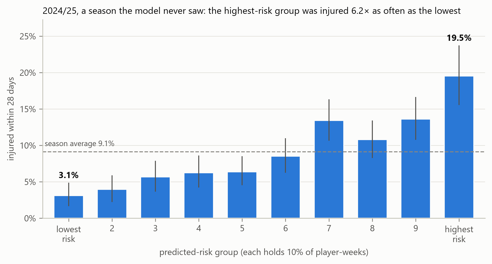
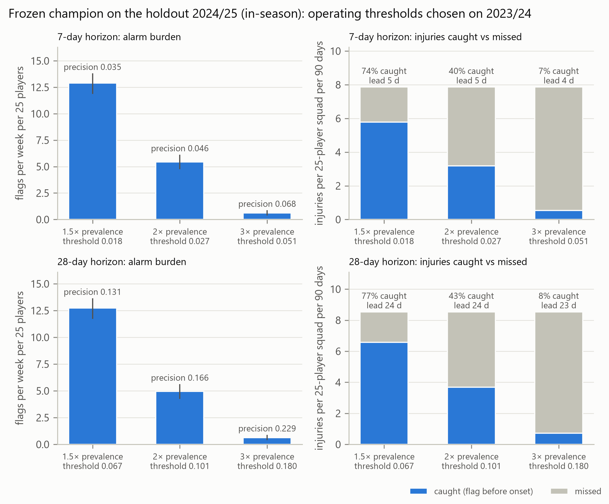
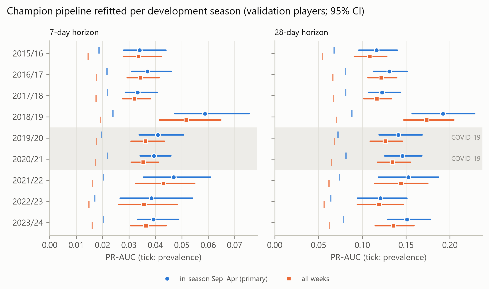
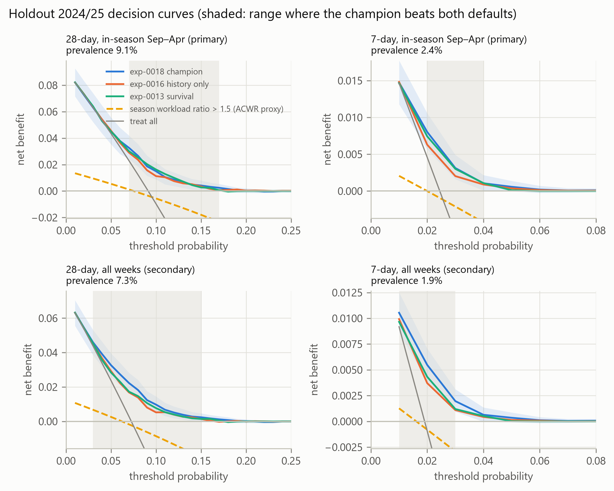

# Football injury risk from public data

**A weekly injury-risk score for every player in Europe's top five leagues, built only from public
records and tested on a full season it had never seen.**

It needs no GPS, no wellness questionnaires and no medical files: only injury history, appearances
and basic player details that anyone can look up. It is a research project, not medical advice.

## The result in one picture

The model was built on ten seasons (2014/15–2023/24). It was then tested once on 2024/25, a
season it had never seen, and on players kept aside from the start. Every Sunday it ranked the
players who were not injured at the time, and we checked who was injured (out for at least 7 days)
in the following 28 days:

- **The 10% of players it rated most at risk: 19.5% were injured**, about one in five.
- **The 10% it rated safest: 3.1%**, about one in thirty.
- **The average player: 9.1%**, about one in eleven.

The highest-risk group was injured **about six times as often** as the lowest-risk group. The
black lines on each bar show the range allowed by chance; the ratio is at least 3.7× even at the
cautious end of that range. Over the 7-day horizon the pattern is the same: 5.2% against 0.8%.

## What this means for a squad of 25

You choose how many players to flag. The thresholds below were fixed on the previous season,
before the test, and the results were then measured once on 2024/25 (playing season, September–April):

| Setting | Players flagged per week | Flagged players injured within 28 days | Share of all injuries the flags caught |
|---|---|---|---|
| Short list | under 1 | about 1 in 4 (22.9%) | 8% |
| Balanced | about 5 | about 1 in 6 (16.6%) | 43% |
| Wide net | about 13 | about 1 in 8 (13.1%) | 77% |
| No model (any player) | — | about 1 in 11 (9.1%) | — |

With the balanced setting you review about five players a week. Those players are almost twice as
likely as an average teammate to be injured in the next month, and their names account for about
four in ten of the squad's injuries. That makes it a way to decide where staff attention goes
first. It does not say who will get hurt.

## It holds up: every season, every league, every type of player

*Each dot shows how well the model ranked players in one season; the small tick shows what guessing
would score. In every season the dot sits well to the right of its tick.*

- **Every season since 2015/16** was better than chance, including the two COVID seasons. The test
  season 2024/25 was an ordinary year for the model, not a lucky one.
- **Every league** (Premier League, LaLiga, Serie A, Bundesliga, Ligue 1), **every position**,
  every age group, and players who played a lot or little the season before: it beat chance in
  each group.
- **It beats the closest workload rule this data allows.** A rule that flags players whose playing
  time jumped compared with earlier seasons had no predictive value at all on the same weeks.
- **It stays simple on purpose.** More complex machine-learning methods (gradient-boosted trees) were
  tested against it and never did better, so the model stays transparent.

## How it works, in plain words

Every Sunday, for each player registered with a top-five-league club and not currently injured, the
model estimates the chance of an injury that keeps him out for at least 7 days and starts within
the next 7 days, or within the next 28 days. It looks at:

- **Injury history:** how many injuries, how recent, which body parts (hamstring, groin, knee, ankle
  …) and how long since he returned.
- **Playing time** in the last two seasons: appearances, starts, minutes.
- **Profile and context:** age, height, position, league, and the point in the season.

The method is logistic regression, a long-established statistical method whose reasoning can be
inspected, followed by a calibration step so that "10% risk" means roughly 10%. It was built on
1.29 million player-weeks of public Transfermarkt records (9,967 players, 2014/15–2024/25).

**Why the numbers can be trusted:**
- **One-shot test.** The test season and the test players were locked away until the end, and the
  test was run exactly once. Its full setup was fixed and saved before it ran, and nothing was
  adjusted afterwards.
- **Every experiment logged.** All 30 experiments are recorded with their settings, including the
  ideas that failed. Chance was accounted for in every comparison.
- **Evidence is public.** All results, figures and the full experiment log are in [results/](results/README.md).

## What it cannot do (please read before using)

- **It is a screening aid, not a diagnosis.** Even in the highest-risk group, four out of five
  players were not injured in the next 28 days. Most flags will be false alarms.
- **It mostly tells you *who* is injury-prone, not *when*.** Scores change slowly from week to week,
  so a flagged player was usually already flagged in earlier weeks. It gives no extra warning beyond
  its 7- or 28-day window.
- **It is weak over the 7-day horizon.** Even the highest-risk group's injury rate over one week
  is about 5%.
- **It cannot see what clubs see.** It has no training load, GPS, sleep, wellness or medical data,
  and no match-by-match minutes. For the same reason it could **not** be compared with the
  acute:chronic workload ratio that many clubs use. That comparison needs dated minutes.
- **Absolute levels drift.** In 2024/25, a season with more injuries than usual, it predicted 7.4%
  against 9.1% observed. In LaLiga it predicted too high (7.6% against 5.7%). Rankings held up better
  than levels.
- **Its low / uncertain / high risk tiers are less reliable for some groups.** Players aged 29+ and
  forwards get more false alarms. Goalkeepers and players aged 23 or under have more injuries
  missed.
- **It has not been tested live yet.** A tool to log weekly scores ahead of time is built and
  tested. It can start once the data is refreshed.
- **It covers men's senior football in the top five leagues only.**
- **The scores are health data** about identifiable people (GDPR Art. 9). Do not publish individual
  scores. Use them with the medical staff, never on their own for selection, contract or transfer
  decisions.

What real use would take: an official dated data feed (the inputs are simple and port directly), a
check of the risk level against the club's own recent injury rate, and an agreed action for flagged
players. A score without an action has no value.

---

## For data scientists

**Primary result.** One-shot holdout 2024/25: test player group (20%, 673 players), in-season
weeks (Sep–Apr, primary). 95% player-cluster bootstrap CIs.

| Metric | 7-day | 28-day |
|---|---|---|
| Prevalence | 0.0245 | 0.0913 |
| PR-AUC (primary metric) | 0.046 [0.038, 0.058] | 0.158 [0.134, 0.188] |
| ROC-AUC | 0.66 | 0.66 |
| Calibration slope / intercept | 0.94 / +0.20 | 0.96 / +0.23 |
| Δ PR-AUC vs first-stage logistic baseline (exposure + demographics) | +0.015 [+0.007, +0.025] | +0.044 [+0.023, +0.068] |
| Δ PR-AUC vs injury-history model without context features | −0.002 [−0.004, +0.002] | −0.003 [−0.011, +0.004] |
| Decision curve: net benefit above treat-all and treat-none | thresholds 2–4% | thresholds 7–17% |
| Mondrian conformal coverage, α = 0.10 | 0.861 (below nominal) | 0.884 |

- All weeks (secondary): PR-AUC 0.042 / 0.145. Part of the all-weeks gain is the football calendar,
  because off-season weeks are near-certain negatives.
- Random survival forest (time to injury): C-index 0.64. It ranks like the classifier and needs no
  post-hoc calibration step.
- LightGBM never beat logistic regression; in the survival arm, XGBoost-AFT did not beat the random
  survival forest.

**Method.**
- **Splits.** Chronological rolling origins with player-grouped splits (players partitioned once
  into train / validation / test). Outcome-window purging and a 7-day embargo.
- **Leakage tests** gate every training run.
- **Promotion rule.** A challenger needs a paired player-cluster bootstrap CI on ΔPR-AUC that
  excludes 0 at both horizons, plus a calibration veto.
- **Calibration.** Platt scaling learned from an inner model's out-of-time scores on half of the
  previous season.
- **Final run.** The configuration was committed before the holdout was scored (commit `e75b51e`).

The full log, the pre-registration, the model card and a claim-by-claim index of the evidence are in
[results/](results/README.md). The practitioner analyses are exp-0024 to exp-0030.

**Layout.**
- `src/`: pipeline (data, features, train, evaluate, report, practitioner analyses, prospective log)
- `tests/`: 78 tests, including data-leakage guards
- `configs/`: one YAML per experiment
- `results/`: published evidence

**Usage.**

    python -m src.cli data
    python -m src.cli features
    python -m src.cli train configs/exp-0018.yaml
    python -m src.cli evaluate configs/exp-0018.yaml
    python -m src.cli freeze                          # rebuild and verify the deployed model
    python -m src.cli analyse configs/exp-0024.yaml   # practitioner analyses (exp-0024 … exp-0030)
    python -m src.cli prospective --date YYYY-MM-DD   # append-only weekly risk log

Equivalent make targets exist for the first four if you have make installed.

**Data.** The data is derived from public web records (player injury and appearance data). Raw and
derived datasets are not redistributed in this repository.

**Requirements.** Python 3.12 (tested with 3.12.10; the pinned numpy needs 3.12 or later); see
`requirements.txt`.
